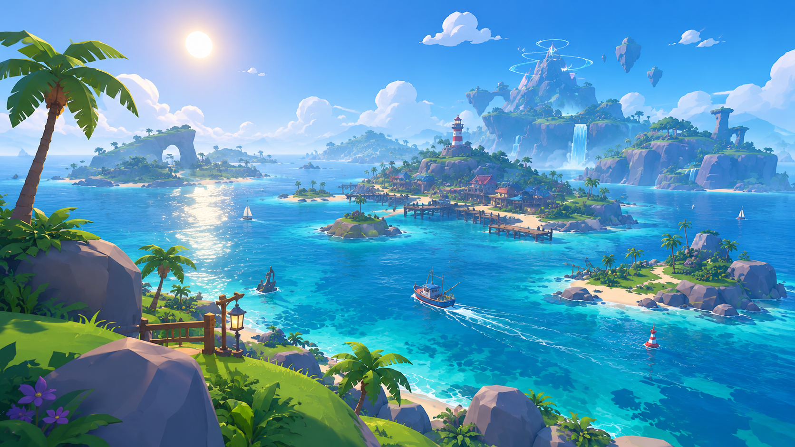

# Hooked-n-Reeled — Production Milestones

> **Current priority: M0, the master ocean map. Do not skip ahead to fishing systems.**
>
> This roadmap is an execution plan for the two development agents working in the Roblox project. It defines what to build, who owns which part, how the parts connect, and what must be demonstrated before a milestone is complete.

## 1. Product direction

Hooked-n-Reeled is an ocean-first fishing adventure. The ocean is the world that connects everything: memorable islands, ports, fishing locations, hidden places, and distant landmarks should make players curious to sail farther.

The intended visual direction is polished, colourful, stylized 3D: clear silhouettes, deliberate geometry, bright tropical shallows, deep blue open water, lush greens, warm sand, coral accents, natural lighting, and readable spaces. Avoid generic flat greybox environments, noisy detail, excessive outlines, and effects that obscure gameplay.

The game should combine:
- **Exploration:** a connected ocean with recognisable destinations and discoveries.
- **Fishing:** satisfying, skill-based catches with meaningful variety.
- **Collection:** distinct fish, discoveries, records, and a fishbook.
- **Boats:** visible progression, personalisation, and useful onboard storage.
- **Shared adventures:** multiplayer trips, special encounters, and world events.

Confirmed design constraints:
- Players must be able to enjoy fishing while staying at one good fishing spot. Exploration is rewarding, but never a requirement for every catch.
- Do not add sonar, tracking devices, scanners, or similar detection gadgets.
- The ocean and destinations should feel connected, not like separate minigame islands.
- Server authority owns catches, currency, inventory, purchases, permissions, and rewards.
- Support PC and mobile from the beginning of each relevant interaction.
- Build a small polished playable slice before expanding content.

## 2. How to use this roadmap

Every milestone has **exactly two packages**. Package A and Package B are parallel workstreams, not fixed agent identities. The agents may swap packages between milestones.

For every milestone:

1. Read this file, [DESIGN.md](../DESIGN.md), [TWO_AGENT_WORKFLOW.md](TWO_AGENT_WORKFLOW.md), and only the relevant system documents.
2. Check the current Roblox project and branch before editing. Do not assume a previous agent's work exists or works.
3. Agree on scope, file ownership, shared interfaces, and the Studio test before coding.
4. Each package has one clear owner. Never let both agents edit the same file concurrently.
5. Build the smallest working version first. Keep the place opening and playable throughout the milestone.
6. Integrate both packages before adding polish. Test the integrated result in Roblox Studio.
7. Record changed files, test evidence, known issues, and decisions requiring user approval.

### Package rules

- **Package A** and **Package B** should be similar in effort. Split by responsibility, not by giving one agent all the hard work.
- Each package must have concrete outputs. “Research”, “make it better”, or “build the system” alone is not an acceptable task.
- Shared contracts are agreed before implementation. Examples: IDs, data shapes, coordinate conventions, remote payloads, ownership rules, and visual scale.
- Do not silently expand scope. Put extra ideas into a follow-up note.
- Use placeholders only when they unblock integration, and label them clearly.
- Do not mark a milestone complete because files exist. The acceptance checks must pass in the integrated Roblox place.
- If a required tool, asset, or Roblox Studio access is unavailable, report the blocker honestly. Do not claim a Studio test was performed when it was not.

### Visual-reference rule

Images under `docs/visual-references/` are concept references by default, not final assets or locked content. They communicate art direction, possible silhouettes, colour, mood, and composition. They do not automatically decide exact geography, species, boat lists, prices, stats, or required props. Written confirmed decisions take priority. Follow [the visual-reference rules](visual-references/README.md).

---

# Phase 1 — Build the world first

## M0 — Create the master ocean map

<badge-placeholder></badge-placeholder>

**Priority:** FIRST. This is the first production milestone.

**Goal:** Turn the world overview concept into a beautiful, coherent, navigable Roblox ocean map. The result should already feel like a real game world from an elevated view, even before every location is fully dressed.

### Required visual reference: WorldOverview.png

**The agents must open and study this exact image before planning or building the map:**

File: `docs/visual-references/01-world/WorldOverview.png`

Use it as the **primary visual and composition reference** for the first world layout. Pay particular attention to:
- The overall island-and-ocean composition and the sense of a large connected world.
- The relationship between the central/main area, smaller island groups, distant destinations, and open-water routes.
- The variety of island silhouettes, coastlines, cliffs, beaches, rock formations, and natural landmarks.
- The colour balance between turquoise shallows, deeper blue ocean, green land, pale sand, and accent colours.
- How the map creates curiosity: visible destinations, interesting gaps, and routes that make players want to sail onward.

**Do not trace or reproduce the image pixel-for-pixel.** Translate its strongest ideas into an original, practical Roblox map. The image is inspiration, not a final coordinate map or a binding list of every island. Keep the confirmed game design authoritative.

If the image cannot be opened, stop and report that specific blocker. Do not quietly substitute a different image or invent what it contains.

### Package A — World layout, geography, and blockout

**Owns:** the map plan and the large-scale world geometry.

1. Study `WorldOverview.png` and write a short visual breakdown of its composition before building.
2. Create a top-down planning layout with:
   - A clear starting region and main harbour area.
   - Several distinct island groups rather than evenly spaced generic islands.
   - Wide navigable ocean channels and readable travel routes.
   - Near, mid-distance, and far-horizon destinations to create a sense of scale.
   - Distinctive large landmarks that can be recognised from a boat.
   - Open space for future locations and expansion.
3. Establish a coordinate system, rough world scale, map bounds, and a simple naming scheme for regions and landmarks.
4. Build the first Roblox Studio blockout:
   - Continuous ocean surface.
   - Main island masses and smaller island silhouettes.
   - Coastlines, beaches, cliffs, reefs, and large rock forms.
   - Clear channels between land masses.
   - Basic navigation clearance for the future boat sizes.
5. Use temporary geometry where detailed assets are not ready. Prioritise composition and navigability over tiny decoration.
6. Capture an elevated overview screenshot and a few boat/player-height screenshots.

**Deliverables:**
- A top-down world layout saved in `docs/`.
- A named list of regions, island groups, routes, and major landmarks.
- A working Studio map blockout with continuous ocean routes.
- Screenshots showing the overall composition and scale.

### Package B — First environment asset kit

**Owns:** reusable environment pieces that help the blockout become a cohesive world.

1. Study the visual language in `WorldOverview.png` and the relevant nature/terrain references.
2. Create a deliberately small first kit:
   - Several palm/tree silhouettes.
   - A few tropical bushes and ground plants.
   - Beach grass and small coastal plants.
   - Multiple rock and boulder shapes.
   - Cliff/shoreline pieces where useful.
   - A few recognisable signature formations.
3. Make assets modular and reusable. Prefer a small number of strong variations over dozens of near-identical objects.
4. Define and document:
   - Naming convention and folder structure.
   - Consistent world scale and approximate player/boat scale.
   - Pivot/origin conventions.
   - Collision approach.
   - Material and colour palette.
   - Performance expectations (part count, mesh reuse, and sensible detail).
5. Deliver the kit in a form Package A can actually place into the map. Do not create an isolated art showcase that cannot be integrated.
6. Keep placeholders simple where a final model would delay the map.

**Deliverables:**
- A usable first environment kit in the Roblox project.
- A short asset guide covering scale, pivots, naming, materials, and collision.
- A small in-map example showing the assets working together.

### M0 shared agreement before work

Both agents must agree on:
- World coordinate system and rough map scale.
- Starting region and main harbour placement.
- Region/landmark naming and ID format.
- Visual palette and material language.
- Asset scale, pivots, and collision conventions.
- The initial set of major silhouettes that must appear in the first blockout.
- How Package B's assets will be handed to and used by Package A.

### M0 integration and acceptance gate

M0 is complete only when all of these are true:

- [ ] The exact `WorldOverview.png` reference was reviewed and used as the primary composition guide.
- [ ] The resulting map is an original interpretation, not a one-to-one copy.
- [ ] The world reads as one connected ocean with navigable routes.
- [ ] The starting region, harbour area, island groups, distant destinations, and major landmarks are identifiable.
- [ ] The map has varied silhouettes and a strong sense of scale from an elevated view.
- [ ] The map is navigable at player/boat height, with no accidental route blockages.
- [ ] The environment kit is reusable and integrated into the map.
- [ ] The palette and assets feel cohesive rather than assembled from unrelated packs.
- [ ] A representative performance check has been made in Studio.
- [ ] Integrated screenshots and a short completion report are saved.

**Do not move to M1 until the user has had a chance to review the master map direction.** If the overall geography or composition needs changing, fix it here before dressing individual locations.

## M1 — Turn the starting area into a playable first impression

**Goal:** Make one compact part of the world feel intentional and welcoming. Do not attempt to finish every island.

### Package A — Starter island and harbour environment
- Build the starter island and immediate coastline using the M0 kit.
- Create a readable arrival point, small dock, beach, paths, and first fishing area.
- Build a first playable slice of the main harbour with room for future services.
- Add a small number of distinctive environmental details.
- Check the space from player height and from the water.

**Deliverables:** polished starter-area slice, compact harbour slice, overview and player-height screenshots.

### Package B — World structure and navigation foundation
- Define stable region/area IDs and world bounds.
- Set up player spawn and safe respawn locations.
- Add basic region entry/exit detection if needed.
- Configure a practical streaming approach for the map.
- Use landmarks and route shapes for natural navigation; avoid permanent waypoint clutter.
- Keep the region structure extensible.

**Shared contract:** region IDs, coordinate system, spawn ownership, streaming boundaries, and how map objects identify their region.

**Acceptance gate:**
- New players spawn in the intended location.
- The starter island and harbour are understandable without instructions.
- Players can travel from the starter area to a nearby fishing area.
- Streaming and region detection do not break travel.
- Initial PC and mobile performance checks are recorded.

## M2 — Give the ocean its visual identity

**Goal:** Make the world feel alive through water, lighting, atmosphere, and environmental dressing.

### Package A — Water, lighting, and atmosphere
- Establish the base lighting and colour grade.
- Create a readable shallow-to-deep water language.
- Build shoreline transitions, restrained foam/wave details, and controlled reflections.
- Add a polished sunny-day setup and one contrasting weather/time-of-day test.
- Keep transparency, particles, and post-processing performant.

### Package B — Environmental dressing and landmarks
- Dress the starter region and nearby routes with the M0 asset kit.
- Add a few memorable landmarks visible from useful distances.
- Define density rules for vegetation, rocks, and props.
- Keep paths, docks, fishing spots, and sightlines readable.
- Check collisions and remove decorative clutter that interferes with play.

**Shared contract:** lighting ownership, material palette, water-depth colours, environment density, and performance budget.

**Acceptance gate:** shallow/deep water is distinguishable, the starter region looks cohesive, landmarks aid orientation, decoration does not obstruct play, and the integrated scene is checked in Studio.

## M3 — Establish the first fishing locations

**Goal:** Create a few different fishing places before building the full fishing system.

### Package A — Fishing spot environments
- Build three initial locations, such as a calm lagoon, rocky coast, and reef edge.
- Give each a distinct silhouette, water appearance, and environmental identity.
- Include at least one satisfying stationary fishing location.
- Ensure each is reachable through the ocean routes.
- Do not force players to travel between spots to make fishing worthwhile.

### Package B — Fishing-area data foundation
- Define stable spot IDs and metadata: region, water type, depth band, and condition tags.
- Add server-side helpers to determine whether a player is inside a valid fishing area.
- Establish a small shared configuration contract.
- Do not add fish selection, rarity rolls, or rewards yet.

**Shared contract:** spot IDs, water/depth vocabulary, region metadata, and player-to-spot detection.

**Acceptance gate:** three distinct reachable spots exist; the server can validate a spot without trusting client claims; stationary fishing remains valid; metadata can expand without rebuilding the map.

---

# Phase 2 — Make fishing genuinely fun

## M4 — Establish the minimum gameplay foundation

**Goal:** Add only the architecture needed for the first complete fishing slice. Avoid building a huge framework before it is needed.

### Package A — Server foundation
- Create the server bootstrap and service lifecycle.
- Define shared types/configuration conventions.
- Add safe player join/leave handling.
- Add a minimal player data wrapper suitable for the first gameplay loop.
- Keep persistence minimal until the actual data model is clear.

### Package B — Client and communication foundation
- Create the client bootstrap and UI mounting structure.
- Define remote-event/function naming and payload conventions.
- Add server validation, rate limiting, and clear error responses.
- Add a small development-only debug/test interface.
- Keep client visuals/input separate from authoritative game state.

**Shared contract:** service names, module ownership, remote names/payloads, data ownership, and error conventions.

**Acceptance gate:** client and server start cleanly; a test request round-trips; malformed/repeated requests are rejected; clients cannot authoritatively set currency, inventory, fish, or rewards.

## M5 — Deliver the first complete fishing loop

**Goal:** One rod, one spot, a tiny temporary fish pool, and a complete cast-to-catch experience.

### Package A — Server fishing encounter
- Implement cast validation, bite timing, hook window, encounter state, and catch resolution.
- Validate player state, position, fishing spot, equipped rod, and request timing.
- Keep the temporary fish pool deliberately small.
- Handle cancellation, timeout, disconnect, and duplicate requests.
- Let the server determine catch outcomes and rewards.

### Package B — Fishing controls and first minigame
- Implement cast input and clear bobber/bite feedback.
- Build one satisfying reeling minigame.
- Support keyboard/mouse and touch.
- Add clear success, failure, cancel, and catch-result feedback.
- Keep common catches quick and readable.

**Shared contract:** encounter state machine, remote payloads, minigame input contract, cancellation rules, and catch-result shape.

**Acceptance gate:** a player can cast, hook, reel, and catch; repeated/invalid requests cannot duplicate rewards; PC and mobile controls work; the first stationary spot supports enjoyable repeat fishing.

## M6 — Add real fish identities and the fishbook

**Goal:** Replace temporary fish with a small original roster and make discoveries meaningful.

### Package A — Starter fish catalogue
- Design a small reviewed roster of original fish.
- Give each species a stable ID, habitat eligibility, size/weight range, silhouette notes, and initial rarity configuration.
- Make species recognisably different in shape and personality.
- Treat `Fish_IDeas.png` only as inspiration, never as the final roster or a list to copy.
- Validate missing and duplicate species IDs.

### Package B — Fishbook discovery
- Implement species discovery and basic fishbook pages.
- Record first catch and personal size/weight records.
- Distinguish unknown and discovered species clearly.
- Keep species discovery separate from ownership of an individual fish.
- Provide a clean path for adding more fish later.

**Shared contract:** species schema, IDs, rarity representation, weight units, and discovery record format.

**Acceptance gate:** the starter roster is reviewed; catching a species records it once; selling/losing an individual fish does not erase discovery; repeated client requests cannot duplicate records.

## M7 — Add fish inventory and selling

**Goal:** Give each catch a reliable identity and a meaningful destination.

### Package A — Fish-instance inventory
- Create unique server-generated IDs for individual fish.
- Store catches with clear capacity and overflow behaviour.
- Implement safe transfers to approved storage.
- Prevent duplicate instances and invalid ownership transfers.
- Define what happens when storage is full.

### Package B — Selling and first economy UI
- Implement a simple sell interaction and readable value display.
- Calculate sale value on the server from approved species/size/rarity data.
- Add a basic currency display and sale confirmation.
- Protect notable catches from accidental irreversible sale.
- Keep economy values configurable rather than hard-coded across UI scripts.

**Shared contract:** fish instance schema, ownership/transfer states, sale valuation, and currency update contract.

**Acceptance gate:** each fish exists in exactly one location/state; selling pays exactly once; fishbook discovery persists; clients cannot choose sale prices or grant currency.

## M8 — Add rods, bait, and first progression

**Goal:** Give players a few meaningful choices without creating a giant equipment catalogue.

### Package A — Rod definitions and equipment
- Define a small starter set of rods with distinct intended roles.
- Implement ownership, equipping, and server-side effect validation.
- Keep stat differences understandable and balanced.
- Make the system data-driven for future rods.

### Package B — Bait, shop, and progression
- Define a small starter set of bait types and their eligible pool/condition effects.
- Implement a simple server-owned shop flow.
- Add readable UI for owned/equipped rods and bait.
- Add a modest early progression reward or unlock.
- Prevent duplicate purchases and insufficient-funds purchases.

**Shared contract:** rod/bait data shape, effect vocabulary, purchase request/result, and balance rules.

**Acceptance gate:** players can buy/equip/switch initial rods and bait; the server validates ownership, prices, and effects; bait changes eligible opportunities in a readable way.

## M9 — Add reeling variety and special catch presentation

**Goal:** Make different catches feel different without making every catch slow.

### Package A — Reeling mechanics
- Add a second and third reusable reeling archetype.
- Assign mechanics to selected species through configuration.
- Tune each mechanic for keyboard/mouse and touch.
- Keep the first mechanic available for suitable species.
- Add clear difficulty and accessibility rules.

### Package B — Catch presentation
- Add rarity-aware sound, animation, camera, and effect hooks.
- Build one notable/rare catch reveal and one boss-style presentation prototype.
- Keep common catches quick and non-disruptive.
- Ensure effects cancel and clean up safely.
- Trigger special reveals only from server-confirmed results.

**Shared contract:** minigame interface, species-to-minigame mapping, presentation event schema, and cancellation/cleanup behaviour.

**Acceptance gate:** at least three mechanics are playable; selected species use the intended mechanics; special reveals are reliable; no effect traps the player or blocks normal play.

---

# Phase 3 — Boats, multiplayer, and world depth

## M10 — Introduce the first boats and ocean travel

**Goal:** Let players own a boat and travel the connected ocean reliably.

### Package A — Starter boat family
- Create a small family of boat hulls with clearly different silhouettes and sizes.
- Make progression visually satisfying: more expensive boats should generally feel larger, cooler, and more capable.
- Keep room for different boat roles and trade-offs.
- Add seats, helm, boarding points, and clear interaction locations.
- Use boat concept sheets as inspiration, not a locked roster or price table.

### Package B — Boat ownership and travel
- Implement purchase/ownership and spawn/despawn flow.
- Add server-validated movement and safe boarding/disembarking.
- Add a simple boat selection/spawn interface.
- Test network ownership and multiplayer movement.
- Ensure boats use the map's actual navigable routes.

**Shared contract:** boat IDs, hull dimensions, ownership state, movement authority, spawn points, and upgrade vocabulary.

**Acceptance gate:** players can acquire, spawn, board, pilot, and despawn an owned boat; guests can board safely; invalid teleporting/ownership is rejected; boats fit through intended routes.

## M11 — Add boat upgrades and personalisation

**Goal:** Make boats feel personal and create a satisfying upgrade path.

### Package A — Upgrades and visual customisation
- Add a small first set of upgrades for speed, handling, stability, and storage support.
- Add paint/colour and a few cosmetic options.
- Separate functional stats from cosmetic appearance.
- Make progression visible and understandable.

### Package B — Onboard placement
- Prototype contextual free placement for a small set of owned objects.
- Support move, rotate, confirm, cancel, and pickup.
- Validate boat bounds, collisions, object limits, and access clearance on the server.
- Start with a few decorative and functional objects, not a huge furniture catalogue.

**Shared contract:** boat save identity, upgrade data, placeable item schema, transform limits, and permission rules.

**Acceptance gate:** upgrades persist and apply server-side; approved objects can be placed/repositioned; helm and boarding access remain clear; mouse and touch placement work.

## M12 — Add coolers and onboard fish storage

**Goal:** Make longer fishing trips useful without risking fish loss or duplication.

### Package A — Cooler objects and capacity
- Add a small set of cooler sizes/tiers.
- Allow coolers on eligible boats.
- Show capacity and contents through a compact contextual UI.
- Define clear full-capacity behaviour.

### Package B — Safe transfers and permissions
- Implement atomic transfers between player inventory and boat coolers.
- Add owner/guest permissions for viewing and depositing fish.
- Prevent guests taking, selling, or moving another player's fish without explicit permission.
- Handle boat despawn, disconnect, and server transfer safely.

**Shared contract:** cooler IDs, capacity schema, fish ownership, transfer state, and guest permission levels.

**Acceptance gate:** a fish cannot exist in inventory and a cooler simultaneously; full storage never silently deletes a catch; server checks permissions; stored fish survive normal despawn/rejoin flows.

## M13 — Add group expeditions and cooperative encounters

**Goal:** Make going out on the ocean with other players feel worthwhile.

### Package A — Group expedition flow
- Add a lightweight way to form/join an expedition or travel group.
- Show group members and basic shared trip status.
- Define owner/leader permissions and clean leave/disconnect behaviour.
- Avoid building a complex guild/clan system.

### Package B — Cooperative fishing encounter
- Prototype one cooperative encounter or boss fish.
- Define participation eligibility and encounter phases.
- Ensure each eligible participant receives their own reward exactly once.
- Make contribution/reward rules clear and server-authoritative.
- Keep solo fishing fully viable.

**Shared contract:** group identity, leader permissions, encounter participation, eligibility, and reward rules.

**Acceptance gate:** players can form and leave a group safely; eligible participants receive one personal reward; late joins/exploits cannot duplicate rewards; solo play remains supported.

## M14 — Add world discoveries and fishing conditions

**Goal:** Give the ocean secrets and changing opportunities while preserving simple, rewarding fishing.

### Package A — Natural fishing conditions
- Add a small set of conditions such as weather windows, time-of-day effects, currents, migrations, or visible schools.
- Communicate conditions through the world itself wherever possible.
- Keep stationary fishing spots rewarding even when no special condition is active.
- Do not add sonar, scanners, tracking devices, or research gadgets.

### Package B — Secrets and special locations
- Add a few discoverable locations, environmental clues, and optional secrets.
- Use landmarks, silhouettes, unusual water/terrain, and exploration rather than detection equipment.
- Ensure discoveries are understandable without external guides.
- Add simple discovery records or rewards where useful.

**Shared contract:** condition vocabulary, world-state timing, discovery IDs, reward ownership, and persistence rules.

**Acceptance gate:** conditions create variety without making ordinary fishing obsolete; secrets are discoverable through the world; no prohibited detection gadget is introduced; rewards are server-validated.

## M15 — Add world events and expand the content slice

**Goal:** Add one or two memorable events and make the existing slice feel cohesive.

### Package A — World event prototypes
- Build one or two event types, such as a migration, unusual weather window, rare school, wreck discovery, or ocean phenomenon.
- Give each event a clear start/end state and readable in-world cues.
- Keep events optional and avoid requiring constant attendance.
- Make event rewards server-authoritative.

### Package B — Content and reliability pass
- Improve the starter regions, fish variety, boat progression, and UI consistency.
- Fix the highest-impact bugs found during playtests.
- Add basic onboarding and clearer feedback for confusing interactions.
- Review economy and progression pacing.
- Record performance and reliability issues for the final milestone.

**Shared contract:** event state, scheduling ownership, participation rules, reward schema, and content acceptance.

**Acceptance gate:** at least one event works end-to-end; players understand how to participate; ordinary gameplay remains viable; major playtest blockers are documented and addressed.

## M16 — Persistence, performance, and release candidate

**Goal:** Make the current game slice reliable enough for a controlled release candidate.

### Package A — Data safety and persistence
- Audit all saved player data and ownership flows.
- Implement robust save/load, retry, and session ownership handling.
- Handle disconnects, server shutdown, and failed saves safely.
- Validate all persisted values and reject malformed client data.
- Test inventory, fishbook, currency, rods, boats, upgrades, and cooler contents.

### Package B — UX, accessibility, and performance
- Profile representative world areas and multiplayer situations.
- Optimise expensive geometry, scripts, effects, and streaming.
- Test on lower-end mobile as well as PC.
- Improve UI readability, input feedback, and accessibility.
- Run a structured regression pass over all core loops.

**Shared contract:** save schema/versioning, migration rules, performance targets, supported devices, and release-blocker severity.

**Acceptance gate:** no known critical data-loss or duplication issue; core gameplay survives normal disconnect/rejoin; PC/mobile checks pass; performance issues are documented; regression checklist is complete.

---

# 4. Milestone handoff template

At the end of **every** milestone, append a short report to the relevant project progress document or milestone log:

- **Milestone:** ID and name.
- **Package A owner / result:** files changed and visible outcome.
- **Package B owner / result:** files changed and visible outcome.
- **Integration:** what was combined and how.
- **Studio evidence:** screenshots/video and the exact test performed.
- **Acceptance:** each checklist item marked pass, fail, or blocked.
- **Known issues:** concrete reproduction steps where possible.
- **Decisions needed:** only questions that genuinely require user direction.
- **Next milestone readiness:** ready / not ready, with reason.

Never mark an acceptance item as passed based only on code inspection if it requires a Studio or multiplayer test.

# 5. Global definition of done

A milestone is complete only when:
- Both packages are integrated in the same working project.
- The agreed shared interfaces match and there are no duplicate/conflicting implementations.
- The acceptance gate passes, or any unpassed item is explicitly marked blocked and approved by the user.
- The result is opened and tested in Roblox Studio when Studio validation is required.
- There are no new critical errors or obvious regressions.
- The progress report and evidence are recorded.

**The next action is M0 Package A + Package B. Start by reviewing `WorldOverview.png`, agree on the map scale and layout, then build the master ocean map blockout and its first reusable environment kit.**
